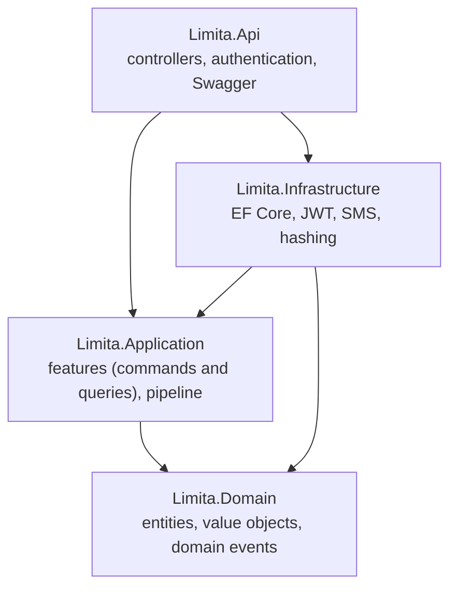
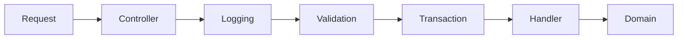

# Limita

**A digital banking and personal finance back-end.** Limita lets users manage accounts, move money, pay bills, set spending limits and save towards goals, all through one secure REST API built with ASP.NET Core 8.


The project is a team effort. It turns a mobile banking UX case study into a working API: the mobile app talks to this service for authentication, accounts, transfers, bills and more.

---

## Table of contents

- [Features](#features)
- [Tech stack](#tech-stack)
- [Architecture](#architecture)
- [Getting started](#getting-started)
- [Configuration](#configuration)
- [Authentication](#authentication)
- [API overview](#api-overview)
- [Database and migrations](#database-and-migrations)
- [Project structure](#project-structure)
- [Conventions](#conventions)
- [Working as a team](#working-as-a-team)
- [Roadmap](#roadmap)
- [Team](#team)

---

## Features

| Area | What users can do |
|---|---|
| **Authentication and verification** | Register, verify the phone number with an SMS one-time code, sign in, refresh tokens, sign out, reset or change the password, manage the profile and preferred language |
| **Accounts** | Open and list accounts in different currencies |
| **Transactions** | View the transaction history and reports |
| **Transfers** | Save beneficiaries (same bank, other bank, card), browse banks and branches, see the transfer fee, send money |
| **Bills** | Look up bills, see what is due, pay a bill, pay all due bills at once (smart pay), view payment history |
| **Mobile top-ups** | Recharge a mobile number from an account |
| **Withdrawals** | Start a cash withdrawal and confirm it with an SMS code |
| **Currency exchange** | List currencies, get a quote, exchange between the user's own accounts |
| **Time deposits** | See the available terms, open a deposit, redeem it at maturity |
| **Spending limits** | Set monthly limits per account or category and get notified at the halfway point and when a limit is exceeded |
| **Notifications and messages** | In-app notifications, and message threads with the bank |
| **Reference data** | Branch locator, interest rates, exchange rates, supported languages, app information |

## Tech stack

| Layer | Technology |
|---|---|
| Runtime and framework | .NET 8, C# 12, ASP.NET Core Web API (controllers) |
| Architecture | Clean Architecture, vertical slices, CQRS with **MediatR** |
| Validation | **FluentValidation** |
| Data | **Entity Framework Core 8**, **SQL Server** (Express for local development) |
| Security | **JWT** bearer tokens, refresh-token rotation, PBKDF2 password hashing, ASP.NET Core rate limiting |
| SMS | Pluggable provider: console output for development, **Twilio** for real delivery |
| API documentation | **Swagger / OpenAPI** (Swashbuckle) |

## Architecture

Limita follows **Clean Architecture**. Dependencies point inward, and the business rules live in the Domain layer, which depends on nothing.



Every request goes through the same MediatR pipeline:



- **Features** are vertical slices: one folder per feature, containing the command or query, its validator and its handler.
- **Commands** change data and run inside a database transaction. **Queries** only read.
- **Results, not exceptions:** expected outcomes (not found, insufficient funds) are returned as `Result` values and become consistent `ProblemDetails` HTTP responses. Input errors come from FluentValidation.
- **Ledger accounting:** a balance changes only through `Account.Credit` and `Account.Debit`, which create immutable transaction records. Amounts use a `Money` value object (decimal, two decimal places, never floating point).
- **Domain events** (for example a new transaction) trigger notifications and spending-limit checks.
- **Idempotency keys** protect payments that can be retried (bill payments, mobile top-ups) from being charged twice.

## Getting started

### Prerequisites

- [.NET 8 SDK](https://dotnet.microsoft.com/download) (a newer SDK also works)
- SQL Server Express (default instance name `SQLEXPRESS`) or any SQL Server
- The EF Core tool: `dotnet tool install --global dotnet-ef --version 8.*`
- Visual Studio 2022 17.13+, JetBrains Rider or VS Code (optional)

### 1. Clone

```bash
git clone https://github.com/KhaledMaher923/Limita.git
cd Limita
```

### 2. Set your local secrets

Secrets are **never committed**. Each developer stores them on their own machine with [.NET user-secrets](https://learn.microsoft.com/aspnet/core/security/app-secrets).

```powershell
# Only needed if Limita/Limita.Api.csproj has no <UserSecretsId> yet (one person runs this and commits the change)
dotnet user-secrets init --project Limita

dotnet user-secrets set "Jwt:SecretKey" "any-development-key-of-at-least-32-characters" --project Limita
dotnet user-secrets set "ConnectionStrings:Default" "Server=.\SQLEXPRESS;Database=Limita;Trusted_Connection=True;TrustServerCertificate=True" --project Limita
dotnet user-secrets set "Sms:Provider" "Console" --project Limita
```

With `Sms:Provider` set to `Console`, one-time codes are printed in the API's console window instead of being sent by SMS.

### 3. Create the database

```powershell
dotnet ef database update --project Limita.Infrastructure --startup-project Limita
```

See [Database and migrations](#database-and-migrations) if the project has no migrations yet.

### 4. Run the API

```powershell
dotnet run --project Limita --launch-profile http
```

Open **Swagger UI** at <http://localhost:5199/swagger>.

## Configuration

| Key | Purpose | Notes |
|---|---|---|
| `ConnectionStrings:Default` | SQL Server connection string | Required |
| `Jwt:SecretKey` | Key that signs access tokens | Required, at least 32 characters, never commit it |
| `Jwt:Issuer`, `Jwt:Audience` | Token issuer and audience | Defaults in `appsettings.json` |
| `Jwt:ExpiryMinutes` | Access token lifetime | Default 15 |
| `Jwt:RefreshTokenDays` | Refresh token lifetime | Default 7 |
| `Sms:Provider` | `Console` (development only) or `Twilio` | An empty value makes sending fail on purpose |
| `Sms:Twilio:AccountSid`, `AuthToken`, `From` or `MessagingServiceSid` | Twilio credentials | Secrets, use user-secrets or environment variables |
| `RateLimiting:AuthPermitLimit` | Requests per minute per IP on public auth endpoints | Default 10 |

In a deployed environment, use environment variables with a double underscore, for example `Jwt__SecretKey` and `Sms__Twilio__AuthToken`.

## Authentication

Limita uses **JWT bearer tokens**. A user signs up, verifies their phone, signs in, and then sends the access token with every request.

```http
POST /api/v1/auth/register        { "fullName", "email", "phoneNumber": "+201001234567", "password" }
POST /api/v1/auth/verify-phone    { "phoneNumber", "code" }              -> 204
POST /api/v1/auth/login           { "email", "password" }                -> tokens.accessToken, tokens.refreshToken
POST /api/v1/auth/refresh         { "refreshToken" }                     -> a new token pair
```

Send the token on protected requests:

```http
Authorization: Bearer <accessToken>
```

In **Swagger UI**, click **Authorize** and paste the token only; Swagger adds `Bearer` itself.

Security design:

- Access tokens are short-lived (15 minutes). **Refresh tokens rotate** on every use, and presenting an already used refresh token ends all of that user's sessions.
- Passwords are hashed with PBKDF2 and a random salt (ASP.NET Core Identity hasher). Passwords need 8+ characters with an uppercase letter, a lowercase letter and a digit.
- One-time codes and refresh tokens are stored only as keyed hashes. Codes expire after 5 minutes and lock after 5 wrong attempts.
- Five wrong passwords lock an account for 15 minutes. Public authentication endpoints are rate limited per IP address.
- Unknown emails and phone numbers get the same answers as known ones, so accounts cannot be discovered by guessing.
- Controllers require authentication by default; public actions must be marked `[AllowAnonymous]` explicitly.

## API overview

Interactive documentation: `/swagger` (Development). Every route requires a token unless marked public.

| Module | Routes |
|---|---|
| **Auth** `api/v1/auth` | `POST register` (public), `verify-phone` (public), `resend-otp` (public), `login` (public), `refresh` (public), `forgot-password` (public), `reset-password` (public), `logout`, `change-password`; `GET` and `PUT me` |
| **Accounts** `api/v1/accounts` | `GET` list, `POST` open |
| **Profile** `api/me` | `GET`, `PUT`, `PUT language` |
| **Transactions** `api/transactions` | `GET` |
| **Transfers** | `GET api/beneficiaries`, `POST api/beneficiaries`, `GET api/transfers/fee`, `POST api/transfers`, `GET api/banks`, `GET api/banks/{id}/branches` |
| **Bills** `api/bills` | `GET lookup`, `GET due`, `GET payments`, `POST pay`, `POST smart-pay` |
| **Mobile top-ups** `api/mobile-topups` | `POST` |
| **Withdrawals** `api/withdrawals` | `POST`, `POST {id}/confirm` |
| **Exchange** `api/exchange` | `GET currencies`, `GET quote`, `POST` |
| **Time deposits** `api/time-deposits` | `GET terms`, `GET`, `POST`, `POST {id}/redeem` |
| **Spending limits** `api/spending-limits` | `GET`, `POST` |
| **Notifications** `api/notifications` | `GET`, `PATCH {id}/read` |
| **Messages** `api/messages` | `GET`, `GET {threadId}`, `POST`, `POST {threadId}/replies` |
| **Reference data** `api` | `GET branches`, `interest-rates`, `exchange-rates`, `languages` (public); `GET api/app-info` (public) |
| **Health** `api/v1/health` | `GET` (public) |

Errors follow the standard `ProblemDetails` format (RFC 7807): `400` validation, `401` not signed in, `403` forbidden, `404` not found, `409` conflict, `422` business rule, `429` too many requests.

## Database and migrations

The schema is managed with **EF Core migrations**, stored in `Limita.Infrastructure/Persistence/Migrations`.

Apply the existing migrations to your local database:

```powershell
dotnet ef database update --project Limita.Infrastructure --startup-project Limita
```

Create a migration after you change an entity or its configuration (one migration per pull request, with a meaningful name):

```powershell
dotnet ef migrations add DescribeTheChange --project Limita.Infrastructure --startup-project Limita --output-dir Persistence/Migrations
```

If the repository has no `Migrations` folder yet, run the command once with the name `InitialCreate`, review the generated files, and commit the whole folder.

Rules for the whole team: never edit a migration that has been merged, pull `master` and run `database update` before you start a model change, and read every generated migration for destructive operations (`DropTable`, `DropColumn`) before committing it. Seed data that uses `HasData` must have fixed ids and dates.

## Project structure

```text
Limita/
├── Limita/                  ASP.NET Core Web API project (Limita.Api): controllers, startup, authentication, Swagger
├── Limita.Application/      Features (one folder per use case), MediatR behaviors, Result and Error types
├── Limita.Domain/           Entities, value objects (Money), enums, domain events and business rules
├── Limita.Infrastructure/   EF Core DbContext and configurations, JWT, password hashing, SMS providers
└── Limita.slnx              Solution file
```

## Conventions

- Dependencies point inward: Api → Application, Infrastructure; Infrastructure → Application, Domain; Application → Domain.
- A feature lives in `Limita.Application/Features/<Feature>`: command or query, validator and handler together.
- Controllers stay thin: they send a command or query through MediatR and return the result.
- Business rules belong in the Domain entities, not in controllers or handlers.
- Handlers never call `SaveChanges`; the transaction behavior saves after a successful command.
- Never log request bodies, card data, one-time codes or tokens.

## Working as a team

- Everyone works locally with their own SQL Server database. The migrations in Git are the shared definition of the schema.
- One branch per feature, a pull request for every change, and at least one review before merging.
- Keep secrets in user-secrets or environment variables. Never commit keys, passwords or connection strings with credentials.
- Pull `master` and apply migrations before starting new work.

## Roadmap

- [ ] Automated tests (unit tests for the Domain and handlers, API integration tests) and a CI pipeline
- [ ] Committed EF Core migrations for the whole schema
- [ ] Production SMS provider configuration and delivery monitoring
- [ ] Bank settlement for transfers to other banks
- [ ] A single managed source for exchange and interest rates
- [ ] Docker setup for one-command local development

## Team

<!-- Replace with the real names and roles of everyone on the team. -->

| Name | Role | GitHub |
|---|---|---|
| Khaled Maher | Authentication and verification | [@KhaledMaher923](https://github.com/KhaledMaher923) |
|  |  |  |

## License

<!-- Choose a license (for example MIT) and add a LICENSE file, or state that the project is private/educational. -->
